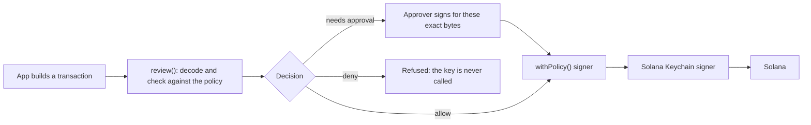
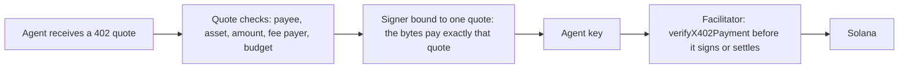

# Signing Firewall for Solana

Signing Firewall for Solana checks a transaction against a policy before your signer signs it. A
TypeScript library on `@solana/kit`, with public test vectors and an x402 module for AI agents
that pay.

**Runs on Solana devnet:** [the recorded run](docs/devnet-run/README.md), 15 scenes, 7 transactions
sent, every blocked scene refused before signing. Video: not published yet.

A devnet proof of concept. It has not been audited. Do not use it to protect mainnet funds.

## The problem

A signer signs whatever bytes it is given. Solana Keychain gives applications one signing interface
across many key backends, and leaves the question of what to sign to them. One wrong payee, a
hidden delegate approval or a fee an instruction scan cannot see, and the key signs it anyway.

## How it works



`review()` decodes legacy, version-0 and version-1 messages, resolves lookup tables, parses P-Token
`batch`, and checks signers, fee payer, lifetime, programs, instructions, transfers, totals and fees
against the policy, from a snapshot of account state. It makes no network calls. `withPolicy()`
wraps any Kit transaction partial signer, a Solana Keychain signer included: it takes its own copy
of every transaction, reviews it before the inner signer sees anything, and verifies every
signature it returns over the reviewed bytes.

```ts
const signer = withPolicy(await createKeychainSigner({ backend: 'memory', keyPair }), {
  policy: parsePolicyText(policyFileText),
  loader: createRpcSnapshotLoader(rpc),
  approvals: (messageDigest) => approvalStore.get(messageDigest),
});
// Use it wherever Kit takes a signer. A refused transaction throws PolicyViolationError.
const message = pipe(
  createTransactionMessage({ version: 0 }),
  (m) => setTransactionMessageFeePayerSigner(signer, m),
  (m) => setTransactionMessageLifetimeUsingBlockhash(latestBlockhash, m),
  (m) => appendTransactionMessageInstructions(instructions, m),
);
const signed = await signTransactionMessageWithSigners(message);
```

For x402, the agent's guard and the facilitator's verifier check the payment from both ends:



## What it blocks

The devnet run of 2026-11-21 ([details](docs/devnet-run/README.md), [table](docs/devnet-run/scenes.md)).
"Signer calls" counts how often the wrapped Keychain signer was asked to sign; scene 15 counts the
facilitator's key.

| #   | Scene                                                                                              | Result                                   | Reason codes                                                                                                                                 | Signer calls | Vectors              | Devnet                                                                                                                                       |
| --- | -------------------------------------------------------------------------------------------------- | ---------------------------------------- | -------------------------------------------------------------------------------------------------------------------------------------------- | ------------ | -------------------- | -------------------------------------------------------------------------------------------------------------------------------------------- |
| 1   | Legacy transfer, 1.00 USDC to vendor A                                                             | allowed, sent                            |                                                                                                                                              | 1            | core-001             | [tx](https://explorer.solana.com/tx/5DAYN3Wu9jSYzZJDD24P7mXc6PcUoMqjDX2kc4KdUYm3szCZbmHgzoJVvT5PSKYBfmXpUextJkHQrDuzBoXdGAqH?cluster=devnet) |
| 2   | v0 transfer through a lookup table, 1.50 USDC to vendor B                                          | allowed, sent                            |                                                                                                                                              | 1            | core-002             | [tx](https://explorer.solana.com/tx/DLw9mgqAV7wKgnxe7Q9Fin5W4THiE73cWUB5av59YNVWMB1MiyVRPaZXLARCuNFAuyQb32UkJPHfSZ3JACh1ooB?cluster=devnet)  |
| 3   | v1 transfer, 0.50 USDC to vendor A, fee read from `transactionConfig`                              | allowed, sent                            |                                                                                                                                              | 1            | core-003             | [tx](https://explorer.solana.com/tx/2GvC2QcuwMhBrVw7yAse8rBSZanQ2nFS8zkVn5bY95yYPkfkTEUo2JWYwvLv5ykpubvKXwEkmLU2w3fmq4M7khEP?cluster=devnet) |
| 4   | P-Token `batch`: 0.40 USDC to vendor A and 0.60 to vendor B in one instruction                     | allowed, sent                            |                                                                                                                                              | 1            | core-004             | [tx](https://explorer.solana.com/tx/2zhSY9RWb9rwFM6aP4oGZU2yg1kMoFpaFxbLW1Y7oQQ3VrhG8Z2oRzG5dHonvgWsH5uFDUX7fHrKbYCpkjFGgpRt?cluster=devnet) |
| 5   | 3.00 USDC to vendor B, above the approval threshold                                                | needs approval; the approver signs; sent | `APPROVAL_REQUIRED`                                                                                                                          | 0, then 1    | core-005, core-016   | [tx](https://explorer.solana.com/tx/2DizYEgJhfXFv8TXinWWGeQxzA9B7P3UsaEpsJHpr4d1V97guQuo7utcCj7hqLDL793eZc9cKbXASRdaKU9Gw3jb?cluster=devnet) |
| 6   | A new message for 4.50 USDC, presented with scene 5's approval                                     | refused                                  | `APPROVAL_MESSAGE_MISMATCH`                                                                                                                  | 0            | core-019             | not sent                                                                                                                                     |
| 7   | 1.00 USDC into the outsider's token account that is not an associated token account                | refused                                  | `RECIPIENT_NOT_ALLOWED`, `DESTINATION_NOT_ASSOCIATED_TOKEN_ACCOUNT`                                                                          | 0            | core-052             | not sent                                                                                                                                     |
| 8   | Three transfers of 2.00 USDC in one transaction (cap 5.00)                                         | refused                                  | `PER_TRANSACTION_LIMIT_EXCEEDED`                                                                                                             | 0            | core-060             | not sent                                                                                                                                     |
| 9   | A `batch` with 0.50 USDC to vendor A and an `Approve` that makes the outsider a delegate           | refused                                  | `TOKEN_INSTRUCTION_NOT_ALLOWED` at `ix[0].batch[1]`                                                                                          | 0            | core-030             | not sent                                                                                                                                     |
| 10  | 1.00 USDC to vendor A with a durable nonce                                                         | refused                                  | `DURABLE_NONCE_NOT_ALLOWED`                                                                                                                  | 0            | core-028             | not sent                                                                                                                                     |
| 11  | v1 transfer with a 0.005 SOL fee in `transactionConfig` and a no-op `SetComputeUnitPrice`          | refused                                  | `FEE_CAP_EXCEEDED`, `COMPUTE_BUDGET_INSTRUCTION_IN_V1`                                                                                       | 0            | core-037             | not sent                                                                                                                                     |
| 12  | x402: the agent buys a report for 0.02 USDC                                                        | allowed, settled                         |                                                                                                                                              | 1            | x402-001, x402-002   | [tx](https://explorer.solana.com/tx/3AgTsRYj5UAYqYVoS86GmY9EnXvaeJn7uRoLjxGv7dkP5MweXwj5viGcSWtagq19Kbg9NBm26BK1wNmWJqYRcMVF?cluster=devnet) |
| 13  | x402: a second shop offers four hostile options                                                    | refused before signing                   | `X402_PAYTO_NOT_ALLOWED`, `X402_FEE_PAYER_NOT_ALLOWED`, `X402_ASSET_NOT_ALLOWED` (the fourth option is removed by the SDK's per-payment cap) | 0            | x402-035 to x402-038 | not sent                                                                                                                                     |
| 14  | x402: a second report (0.04 USDC today), then a third against a 0.05 USDC daily budget             | second settled, third refused            | `X402_BUDGET_EXCEEDED`                                                                                                                       | 1, then 0    | x402-041             | [tx](https://explorer.solana.com/tx/549rPqREiN8Wer3vKXioqVS2JCQzQGBNW1xhTAwQiZWPi71AsEBDX7j33YXTg9kioSidh7kBFcHe5R1Ju4bgFGdd?cluster=devnet) |
| 15  | x402, facilitator side: a payment whose token instruction is `ApproveChecked`, posted to `/verify` | invalid; not signed or settled           | `X402_NOT_TRANSFER_CHECKED`                                                                                                                  | 0            | x402-004             | not sent                                                                                                                                     |

`pnpm verify-run` fetches each sent transaction and compares it with the bytes that were reviewed:
7 of 7 match. All names in the demo (Orrin & Vale, Thistledown Print, Cobbleway Freight, Lantern
Row) are fictional. In the demo the approver's key sits on the same machine as the treasury's, so
one person plays both roles; in real use the approver is a different person on a different device.

## x402 payments

An agent that pays for APIs with x402 holds a key that can sign any payment a server asks for.
Solana's [x402 guide](https://solana.com/developers/guides/getstarted/intro-to-x402), in its section
"Build a payment-aware client", says a production agent should get "a signing interface with
per-payment and cumulative limits" rather than a raw private key. The guard is that interface, and
it plugs into the client the guide builds. It refuses quotes outside the policy, binds the key to
the one quote the agent accepted, checks that the bytes pay exactly that quote, and reserves the
daily budget before the key signs.

```ts
const guard = createX402Guard({ inner: agentSigner, policy, loader, ledger });
const client = new x402Client(); // the SDK's own spend controls stay on
client.registerPolicy(x402RequirementsFilter(guard));
client.register('solana:*', new GuardedExactSvmScheme(guard, { rpcUrl }));
const paidFetch = wrapFetchWithPayment(fetch, client);
```

A facilitator checks a payment before it signs as fee payer or settles it. The check is static and
does not simulate the transaction, so a payment it calls valid can still fail on chain: put it in
front of a facilitator scheme that simulates, not in place of one.

```ts
// Wrap the facilitator scheme: a refused payment never reaches it.
const scheme = withX402Verifier(new ExactSvmScheme(toFacilitatorSvmSigner(feePayer)), {
  config,
  loader,
  network: 'devnet',
});
// Or the check alone, in front of your own facilitator's simulation:
const decision = await verifyX402Payment({ transaction, requirements, config, snapshot, now });
```

In v0.1.0, an x402 payment above `approvalAbove` is refused, because there is no human approval for
x402 payments; Token-2022 payments are refused by the guard and the verifier; and the file budget
ledger serves one process, and anyone who can edit the file can reset the budget. Details:
[docs/X402.md](docs/X402.md).

## Quickstart

Node.js 22 and pnpm (`corepack enable`). After the install, everything runs offline.

```sh
git clone https://github.com/nexbridge-xyz/solana-signing-firewall.git
cd solana-signing-firewall
pnpm install --frozen-lockfile
pnpm test              # unit, property and LiteSVM tests
pnpm fixtures          # run the 69 core and 49 x402 vectors
pnpm demo:rehearse     # the whole devnet demo against a local LiteSVM RPC
```

The devnet demo itself (`pnpm demo:keys`, `demo:setup`, `demo`, `verify-run`, `demo:record`,
`demo:recycle`) needs devnet SOL and USDC from the public faucets; see
[docs/devnet-run](docs/devnet-run/README.md).

Quality: 481 tests; line coverage 98.1% of `packages/signing-firewall`. CI runs typecheck, lint,
the format check, tests, the vector diff, secret scanning and a dependency audit on every push.

## Test vectors

69 core vectors and 49 x402 vectors in `packages/fixtures/vectors`, one JSON file each: the bytes,
the policy, the account state and the expected answer, so another wallet, signer or x402
implementation can run them without this code. Each core vector also records what the Solana runtime
does with the transaction against its snapshot; LiteSVM confirms it for 64 of them, and the other
five are bytes LiteSVM 1.6.2 cannot read or a program it does not load. Each x402 vector records
whether the pinned x402 spec has a MUST that makes every facilitator (for a quote, every client)
refuse it, or whether our guard or verifier is stricter than the spec, with the sentence or the
decision it rests on.
Format and open questions: [docs/FIXTURES.md](docs/FIXTURES.md).

## Support

Legacy, v0 and v1 messages; SPL Token `TransferChecked` and P-Token `batch`; ComputeBudget limit and
price; SPL Memo. Everything else is refused, not guessed at. Signer backends: works in front of
Keychain backends that sign the bytes they are given; tested with the memory backend. Details:
[docs/SUPPORT_MATRIX.md](docs/SUPPORT_MATRIX.md).

## Trust model and limits

- The wrapper protects calls that go through it. Code that holds the raw key, or the credentials of a
  remote signer, can still sign directly.
- `review()` decides from the snapshot its loader fetched; a dishonest RPC can report false account
  state, and through a lookup table it can redirect a version-0 payment. The decision records the
  snapshot slot.
- Nothing in the signed bytes names a cluster: a signature is valid on any cluster where the same
  accounts exist. Use a key on one cluster only.
- Not covered: Token-2022, multisig authorities, other programs, limits across transactions outside
  x402.

Full threat model: [docs/THREAT_MODEL.md](docs/THREAT_MODEL.md). Reporting a vulnerability:
[SECURITY.md](SECURITY.md).

## Roadmap

- Grant milestones: the x402 conformance work (vectors for every rule of the `exact` scheme on
  Solana, differential runs against other implementations) and budget reconciliation against what
  settled.
- Token-2022 `TransferChecked` for mints without extensions, behind a policy switch.
- Tests against more Keychain backends.
- Limits across transactions for the core policy.

## Documents

[Architecture](docs/ARCHITECTURE.md) · [Policy format](docs/POLICY.md) ·
[Reason codes](docs/REASON_CODES.md) · [Vectors](docs/FIXTURES.md) · [x402](docs/X402.md) ·
[Support matrix](docs/SUPPORT_MATRIX.md) · [Threat model](docs/THREAT_MODEL.md) ·
[Decisions](docs/DECISIONS.md) · [Changelog](CHANGELOG.md) · [Contributing](CONTRIBUTING.md)

## Team

Built by NexBridge Inc., a Tokyo company building payment and custody infrastructure for licensed
financial institutions. [nexbridge.xyz](https://nexbridge.xyz) ·
[x.com/0xNexBridge](https://x.com/0xNexBridge)

## License

Apache-2.0. Copyright 2026 NexBridge Inc.
