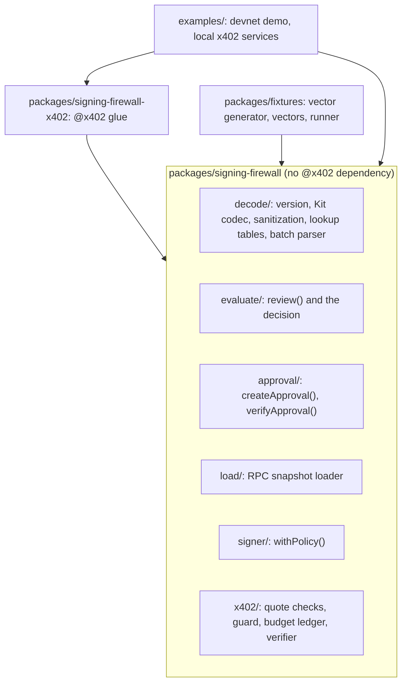
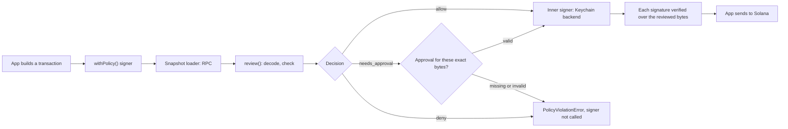
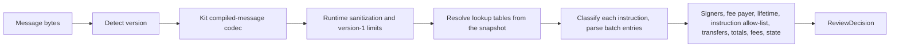
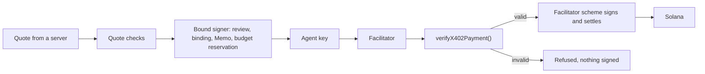

# Architecture

Signing Firewall for Solana reads a transaction before a signer signs it, checks it against a
policy, and lets the signer sign only what passes. It is a TypeScript library on `@solana/kit`. The
core makes no network calls: it decides from the message bytes, the policy, a snapshot of account
state and the time.

## Packages

- `packages/signing-firewall` is the library. It depends on Kit, the program client packages and
  `@noble/hashes`, never on `@x402`.
- `packages/signing-firewall-x402` connects the guard and the verifier to `@x402/core` and
  `@x402/svm`: `x402RequirementsFilter`, `GuardedExactSvmScheme`, `withX402Verifier`.
- `packages/fixtures` generates the public test vectors and runs them (docs/FIXTURES.md).
- `examples/` holds the devnet demo (`devnet-payouts`, `x402-agent`, `demo-common`).

## Signing path

`withPolicy(inner, { policy, loader, approvals })` returns a Kit `TransactionPartialSigner` (and a
valid Keychain `SolanaTransactionSigner`), so it drops into Kit's signing helpers in place of the
inner signer. For every call it:

1. loads a snapshot for each transaction and runs `review()`;
2. for a decision that needs approval, looks up an approval by message digest and verifies it;
3. refuses the whole call, before the inner signer sees anything, if any transaction fails;
4. calls the inner signer once, for all transactions;
5. checks that each result is exactly one signature, by the inner signer, valid over the reviewed
   message bytes (`SIGNATURE_INVALID` otherwise).

## `review()`

The decision holds the outcome (`allow`, `needs_approval`, `deny`), every failing reason
(docs/REASON_CODES.md), the message digest (SHA-256 of the message bytes), the policy digest, the
version, fee payer and required signers, the lifetime, each transfer with its path, the totals per
mint, the fee summary, the lookup-table entries used and the snapshot slot. `decisionToJson()`
gives its JSON form for logs and recorded runs.

`review()` never assumes account state. The snapshot maps each address it fetched to an account or
to `null` (fetched and absent); an address it never fetched is missing from the map, and a check
that needs it fails with `ACCOUNT_STATE_MISSING`.

## Snapshot loader

`createRpcSnapshotLoader(rpc)` fetches what `review()` needs in two rounds: first the lookup tables
the message names, then the mint, source and destination of every transfer, with
`minContextSlot` so the second round is not older than the first. Accounts that do not exist are
recorded as `null`. Before its first load for a network it checks the RPC's genesis hash against
the policy's `network` (`assertRpcNetwork()`); `localnet` skips the check. A loader is any object
with `load(messageBytes, { network })`, so a node of your own, or several providers compared, can
replace it.

## Approvals

An approval is a small signed record: the message digest, the policy digest, `issuedAt`,
`expiresAt`, the approver's address and an Ed25519 signature over the canonical JSON of the rest,
prefixed with `solana-signing-firewall.approval/v0\n`. It covers those exact bytes under that exact
policy; a changed amount, a new blockhash or an edited policy needs a new approval.
`createApproval()` takes any Kit message signer, so an approver can sign with a Keychain backend
of their own.

## x402

The guard and the verifier are described in docs/X402.md.

## Digests

| Digest       | Over                                                                               |
| ------------ | ---------------------------------------------------------------------------------- |
| message      | SHA-256 of the message bytes (what the signer signs), hex                          |
| policy       | SHA-256 of the RFC 8785 canonical JSON of the policy file as given, hex            |
| requirements | SHA-256 of the RFC 8785 canonical JSON of one x402 payment option as received, hex |

All three are synchronous (`@noble/hashes`), because `x402Client.registerPolicy()` calls the quote
checks synchronously.
