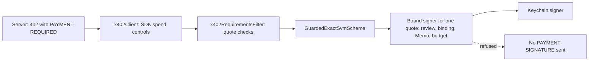

# x402 payments

x402 lets an HTTP server ask for a payment (`402` with `PAYMENT-REQUIRED`), and a client pay it
with a signed transaction (`PAYMENT-SIGNATURE`) that a facilitator verifies and settles. Signing
Firewall checks both sides of the Solana `exact` scheme:

- **The agent side**, with `createX402Guard()`: which quotes the agent may pay at all, and whether
  the bytes it is about to sign pay exactly the quote it accepted.
- **The facilitator side**, with `verifyX402Payment()` and `withX402Verifier()`: whether a payment
  a client sent is what the quote asked for, before the facilitator signs it as fee payer or
  settles it.

The rules follow the official `specs/schemes/exact/scheme_exact_svm.md` in `x402-foundation/x402`,
commit `4f64aba41` (2026-11-06). Tested with `@x402/core`, `@x402/fetch`, `@x402/express` and
`@x402/svm` 2.31.0. Versions below 2.23.0 must not be used (see THREAT_MODEL.md).

## Agent side



```ts
const guard = createX402Guard({
  inner: keychainSigner, // any Kit partial signer: Solana Keychain, a KeyPairSigner, ...
  policy: parsePolicyText(agentPolicyText), // a policy file with an "x402" block (docs/POLICY.md)
  loader: createRpcSnapshotLoader(rpc),
  ledger: await openFileLedger('budget.json'),
});
const client = new x402Client(); // the SDK's spend controls stay on
client.registerPolicy(x402RequirementsFilter(guard));
client.register('solana:*', new GuardedExactSvmScheme(guard, { rpcUrl }));
const paidFetch = wrapFetchWithPayment(fetch, client);
```

The SDK runs its own spend controls before any registered policy. By default they keep only the
SDK's known assets and cap each payment at $1; `spendControls: false` turns them off. They limit
the amount of each payment. The payee, the asset, the fee payer and the total spent over time are
the guard's job.

### Quote checks

`x402RequirementsFilter` runs `guard.checkRequirements()` on every option and keeps only those that
pass. It is synchronous, because `registerPolicy()` is. An option is refused when:

- the requirements are malformed (`X402_REQUIREMENTS_MALFORMED`), or name a scheme, network or
  asset the policy does not list (`X402_SCHEME_NOT_ALLOWED`, `X402_NETWORK_NOT_ALLOWED`,
  `X402_ASSET_NOT_ALLOWED`);
- `payTo` is not in `recipients.owners` (`X402_PAYTO_NOT_ALLOWED`);
- `extra.feePayer` is missing, is the agent itself, or is not in `feePayers`
  (`X402_FEE_PAYER_NOT_ALLOWED`);
- the amount is zero, above the mint's `maxPerTransaction` (`X402_PER_PAYMENT_LIMIT_EXCEEDED`), or
  above `approvalAbove` (`APPROVAL_REQUIRED`: payments never wait for a person);
- `maxTimeoutSeconds` is above the policy's (`X402_TIMEOUT_OUT_OF_RANGE`);
- `extra.splits` is not empty (`X402_SPLITS_NOT_ALLOWED`), or `extra.ataCreationRequired` is true
  (`X402_CREATE_ATA_NOT_ALLOWED`);
- the offered `transactionVersions` share none with `messageVersions` (`VERSION_NOT_ALLOWED`);
- the payment would exceed the rolling 24-hour budget (`X402_BUDGET_EXCEEDED`) or the rate limit
  (`X402_RATE_LIMIT_EXCEEDED`).

### The bound signer

`GuardedExactSvmScheme` gives the SDK's `ExactSvmScheme` a signer bound to the one quote the SDK
chose, `guard.signerFor(requirements)`. It signs once (`X402_SIGNER_ALREADY_USED` after that).
Before it calls the key, in this order:

1. `review()` of the message bytes against the policy, with a fresh snapshot.
2. The quote checks again, against the budget as it is now.
3. The binding checks: the bytes pay this quote and nothing else. Exactly one `TransferChecked`
   of the quoted asset and amount (`X402_NOT_TRANSFER_CHECKED`, `X402_MINT_MISMATCH`,
   `X402_AMOUNT_MISMATCH`), from the payer's own associated token account for the asset
   (`X402_SOURCE_NOT_PAYER_ATA`) into that of `payTo` (`X402_DESTINATION_NOT_PAYTO_ATA`), with the
   quoted fee payer (`X402_FEE_PAYER_MISMATCH`); neither that fee payer nor any other the policy
   lists appears in an instruction (`X402_FEE_PAYER_IN_INSTRUCTION`); the compute-unit price within the
   cap (`X402_COMPUTE_UNIT_PRICE_EXCEEDED`); no lookup table (`X402_LOOKUP_TABLE_NOT_ALLOWED`); an
   accepted layout (`X402_LAYOUT_INVALID`, below); and a message version the quote advertises,
   never legacy (`VERSION_NOT_ALLOWED`). The verifier does not apply that last check: a
   facilitator enforces its own accepted versions and does not read the quote's.
4. The Memo rule (`X402_MEMO_MISMATCH`, below).
5. The budget reservation: the ledger checks the daily budget and the rate limit and records the
   reservation in one atomic step (`reserve()`). Only then is the key called.

A reservation is never released, even when the payment does not land, and one dated after now (a
clock that moved back) still counts: the ledger fails closed (D43).
Reconciling reservations with what settled belongs to a later version.

### Budget ledger

`createMemoryLedger()` is for tests. `openFileLedger(path)` keeps reservations in a JSON file,
writes it through a temporary file and a rename, and holds a `.lock` file while open, so a second
process refuses to start. After a crash, a person deletes the lock file. The budget is per mint over
a rolling 24 hours; the rate limit counts all mints over 60 seconds. Anyone who can edit the file
can reset the budget (THREAT_MODEL.md).

## Facilitator side

```ts
const scheme = withX402Verifier(new ExactSvmScheme(facilitatorSigner), {
  config: parseVerifierConfig(verifierConfigJson),
  loader: createRpcSnapshotLoader(rpc),
  network: 'devnet',
});
const facilitator = new x402Facilitator().register(
  'solana:EtWTRABZaYq6iMfeYKouRu166VU2xqa1',
  scheme,
);
```

`withX402Verifier()` wraps any facilitator scheme. Its `verify` and `settle` first run
`verifyX402Payment()` on the payment; when that refuses, the inner scheme is never called, so the
facilitator neither signs nor simulates the transaction. The refusal comes back as
`invalidReason: "solana-signing-firewall:<CODE>"`, with every code in `invalidMessage`.

`verifyX402Payment()` is pure: it takes the base64 transaction, the requirements, the verifier
config, a snapshot and the time, and makes no network calls. Any buyer may pay: there is no policy
signer. The buyer is the transfer authority. It checks the fee payer isolation of §2.1.1 for every
fee payer of its config, the signer set of §2.1.4, the buyer's signature
(`X402_PAYER_SIGNATURE_INVALID`), the source account (`X402_SOURCE_ACCOUNT_MISSING`), the caps of
§2.2.1, and the same binding and layout rules as the guard, with the verifier's own Memo rule. The
source must be the buyer's associated token account for the asset (`X402_SOURCE_NOT_PAYER_ATA`), so
a payment cannot come out of an account the buyer is only a delegate of: the payee's own account,
which would pay the payee nothing, or a fee payer's, which §2.1.3 forbids (D54).

`valid` is a static verdict. The verifier does not simulate the transaction, so a payment it calls
valid can still fail on chain (a compute-unit limit too low for the transfer, a second Memo that is
not UTF-8, a Memo that lists an account that is not a signer, a source that holds too little) and
still cost the fee payer its fee. Put `verifyX402Payment()` in front of a facilitator that
simulates, not in place of one: `withX402Verifier()` runs it before the scheme it wraps. It takes
`now` but does not use it in v0.1.0, and it does not check `maxTimeoutSeconds`.

The verifier config (`solana-signing-firewall.x402-verifier/v0`) lists the networks, the
facilitator's fee payers, the message versions, the accepted assets with their decimals, the
compute-unit limit and price caps, a total priority-fee cap, the number of required signatures,
and `deny` for durable nonces, recipient account creation and lookup tables.

## Layout

The spec allows several layouts (§1.3, §3.1). We accept a strict subset:

| Version | Instructions                                                            | Fees                                                                                       |
| ------- | ----------------------------------------------------------------------- | ------------------------------------------------------------------------------------------ |
| 0       | `SetComputeUnitLimit`, `SetComputeUnitPrice`, `TransferChecked`, `Memo` | from the ComputeBudget instructions                                                        |
| 1       | `TransferChecked`, `Memo`                                               | from `transactionConfig`; `computeUnitLimit` and `loadedAccountsDataSizeLimit` must be set |

This is what `@x402/svm` 2.31.0 builds. A version-1 payment with any ComputeBudget instruction is
refused (`COMPUTE_BUDGET_INSTRUCTION_IN_V1`): the runtime ignores those instructions, so a reader
that trusts them would misread the fee. For version 1, the price cap of §1.5 is checked as
`priorityFee × 1,000,000 ≤ cap × computeUnitLimit`.

## Memo

The spec says a client must include a Memo: `extra.memo` when the seller sets one, otherwise a
nonce of at least 16 random bytes, hex-encoded. The two sides apply different rules on purpose
(D7):

- **Guard.** Exactly one SPL Memo, after the transfer, with no accounts. With `extra.memo`, its
  bytes equal it exactly. Without it, exactly 32 characters of `0-9a-f`, which is what the pinned
  SDK builds. A different format means the SDK changed or was replaced, and the Memo is where an
  agent's key would otherwise sign arbitrary content onto the chain. With `extra.memo` it still
  does: the text is the seller's choice (or that of a replaced SDK, which hands the guard the
  quote), up to 256 bytes of any valid UTF-8. Only the policy's `memo.maxBytes` bounds it
  (THREAT_MODEL.md).
- **Verifier.** No Memo before the first `TransferChecked`; with `extra.memo`, exactly one Memo
  that equals it byte for byte; without it, at least one Memo whose data is a hex nonce of at least
  32 characters. The spec states the first two for the reference implementation's static path
  (§3.1) and the third for clients, so the verifier is stricter than a MUST that binds every
  facilitator (D53). It accepts any nonce the client rule allows: a facilitator takes payments from
  other implementations, and a narrower rule would refuse compliant ones.

The open points of the spec (letter case, odd length, upper bound, extra Memos, Memo accounts) are
listed in `docs/FIXTURES.md`.

Only the SPL Memo program `MemoSq4gqABAXKb96qnH8TysNcWxMyWCqXgDLGmfcHr` counts as Memo; it is the
one the x402 scheme names and the SDK uses. Since `@solana-program/memo` 0.16, that package's
`MEMO_PROGRAM_ADDRESS` names a newer program, and the SPL Memo address is exported as
`LEGACY_MEMO_PROGRAM_ADDRESS_V3`. In v0.1.0 an instruction to the newer program is
`PROGRAM_NOT_ALLOWED`, and the reason carries its address. A test checks that our Memo address
equals the one in the transactions the SDK builds.

## Where we are stricter than the spec

The guard and the verifier refuse some payments that no MUST binding every facilitator requires
them to refuse. A rule that only the reference implementation's static path states (§3.1), or that
holds only under one of its default settings, counts as stricter here. The vectors of these rules
are `stricter_than_spec` (`docs/FIXTURES.md`); D53 lists the verifier's.

| Rule                    | The spec at `4f64aba41`                                                                                                                                                 | Here                                                                                                                                  | Vectors                      |
| ----------------------- | ----------------------------------------------------------------------------------------------------------------------------------------------------------------------- | ------------------------------------------------------------------------------------------------------------------------------------- | ---------------------------- |
| Amount                  | at least the quoted amount; overpayment tolerated (§1.4)                                                                                                                | exactly the quoted amount (`X402_AMOUNT_MISMATCH`)                                                                                    | x402-008                     |
| Layout                  | the static path permits Lighthouse guard instructions and allowlisted instruction tuples (§3.1); other token instructions and P-Token `batch` are not mentioned         | the SDK layouts only (`X402_LAYOUT_INVALID`, `X402_NOT_TRANSFER_CHECKED`); no vector holds a Lighthouse instruction or a tuple        | x402-010, x402-011, x402-029 |
| Seller account creation | `CreateIdempotent` only for a recipient marked `ataCreationRequired`, whose owner is a declared recipient, from a sponsor that advertises `ataCreationSponsored` (§5.4) | refused (`X402_CREATE_ATA_NOT_ALLOWED`)                                                                                               | x402-032                     |
| Lookup tables           | allowed in version 0 if the sponsor resolves them (§2.1.2); "A version-1 message MUST NOT use Address Lookup Tables" (§1.5)                                             | refused (`X402_LOOKUP_TABLE_NOT_ALLOWED`)                                                                                             | x402-018                     |
| Token-2022              | allowed (§1.1)                                                                                                                                                          | refused in v0.1.0 (`TOKEN_PROGRAM_NOT_ALLOWED`)                                                                                       | x402-009                     |
| Compute-unit price      | a setting of the static path, `maxPriorityFeeMicroLamports`, default 5,000,000 micro-lamports per unit (§3.1, §2.2.1)                                                   | the configured cap (`X402_COMPUTE_UNIT_PRICE_EXCEEDED`)                                                                               | x402-015                     |
| Total priority fee      | no total cap                                                                                                                                                            | also `maxPriorityFeeLamports` (`FEE_CAP_EXCEEDED`)                                                                                    | x402-015                     |
| Fee payer               | not stated that it must be `extra.feePayer`                                                                                                                             | it must (`X402_FEE_PAYER_MISMATCH`)                                                                                                   | x402-013                     |
| Durable nonce           | not mentioned                                                                                                                                                           | refused (`DURABLE_NONCE_NOT_ALLOWED`)                                                                                                 | x402-014                     |
| Buyer's signature       | no rule asks a sponsor to verify it                                                                                                                                     | it must verify (`X402_PAYER_SIGNATURE_INVALID`)                                                                                       | x402-019                     |
| Buyer's token account   | not stated                                                                                                                                                              | it must exist (`X402_SOURCE_ACCOUNT_MISSING`) and be the buyer's associated token account for the asset (`X402_SOURCE_NOT_PAYER_ATA`) | x402-020, x402-046, x402-048 |
| Amount in the quote     | "All amounts are integers in base units." (§5.2); zero is not mentioned                                                                                                 | malformed (`X402_REQUIREMENTS_MALFORMED`), zero refused (`ZERO_AMOUNT`)                                                               | x402-022, x402-039           |
| Memo                    | clients must include one (§3.1); for a facilitator the count is constrained only with `extra.memo`                                                                      | the verifier: a hex nonce of at least 32 characters; the guard: exactly 32 lower-case hex characters, one Memo, no accounts           | x402-023 to x402-030         |
| Version-1 budget fields | clients must set `computeUnitLimit` and `loadedAccountsDataSizeLimit` (§1.5); for a sponsor this is part of §2.2.1 (SHOULD)                                             | required (`X402_LAYOUT_INVALID`, `COMPUTE_UNIT_LIMIT_MISSING`)                                                                        | x402-044                     |

Splits are not in this table: a sponsor that does not advertise `maxSplits` "MUST reject
requirements carrying a non-empty `splits` array" (§5.5), and the local facilitator advertises none.
The guard refuses every split (`X402_SPLITS_NOT_ALLOWED`); for a client the spec says "Before
signing, the client MUST verify that `extra.splits` — when present — contains only the recipients
and amounts it expects." (§5.6, vector x402-031).

## Version 1 payments

The guard and the verifier support version-0 and version-1 payments. The local facilitator of the
demo advertises `[0, 1]`, so the SDK builds version 1. In the devnet run of 2026-11-20 both
settlements were version-1 transactions, so the fallback to `[0]` that D6 provides for was not
needed.

## Demo

`examples/x402-agent` runs a facilitator, a shop and a second, hostile shop on `127.0.0.1` only,
and scenes 12 to 15 of the devnet demo: a purchase, four hostile quotes, a budget overrun, and a
forged payment posted to the facilitator's `/verify`. `pnpm demo:rehearse` runs them against a
local LiteSVM RPC.
